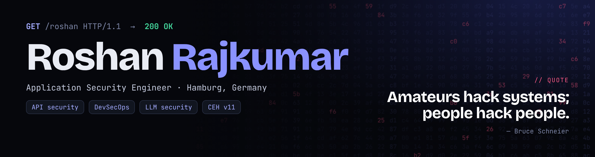

<p align="center">
  
</p>

```http
GET /roshan HTTP/1.1
Host: github.com

HTTP/1.1 200 OK
X-Role: Application Security Engineer
X-Location: Hamburg, Germany
X-Available-From: 2026-12-01
```

### Hi, I'm Roshan 👋

I break web apps and APIs before attackers do, and build the tools that make it repeatable.
Four years of hands-on AppSec at **Oracle**, **Teradata** and **novomind**. M.Sc. at TU Hamburg, researching how to make LLM-generated code more secure.

### 🌐 Portfolio → **[roshanrajkumar1208.github.io](https://roshanrajkumar1208.github.io)**

| Built | What it does |
|---|---|
| [**RAVEN**](https://roshanrajkumar1208.github.io/#tools) | Python CLI that automates vulnerability detection and security testing for REST APIs |
| [**Secure-Code Prompt Optimizer**](https://roshanrajkumar1208.github.io/#tools) | Evolves LLM prompts (GrIPS × EvoPrompt) so generated Python code has fewer vulnerabilities, scored by SAST |

**Focus:** API security · DevSecOps · LLM security
**Certs:** CEH v11 · OSCP (in progress) · OCI Foundations
**Toolbox:** Burp Suite · OWASP ZAP · Snyk · Coverity · Black Duck · Jenkins · GitLab CI · Python · Bash

📫 roshanrajkumar1208@gmail.com · [LinkedIn](https://www.linkedin.com/in/roshan-r-a838911b2)
